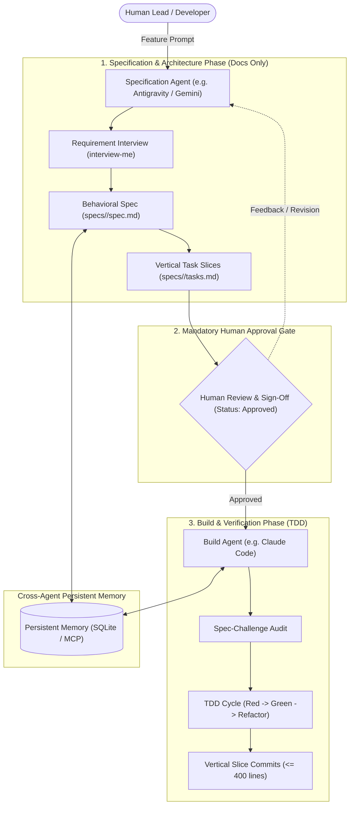

# Spec-Driven AI Development Workflow

[](LICENSE)
[](https://github.com/fededlV/spec-driven-ai-workflow/actions)
[]()
[]()

> **Stop uncontrolled AI code generation, hallucinations, and scope creep.**  
> A disciplined multi-agent engineering workflow that enforces a formal **Separation of Duties**:  
> **Specification & Architecture Agent (Docs Only) $\rightarrow$ Human Approval Gate $\rightarrow$ Build Agent (TDD Implementation).**

---

## The Problem: The Single-Agent Dilemma

Most developers use AI coding assistants in an unconstrained, monolithic loop:
- You give an agent a vague prompt.
- The agent invents architecture, writes 500+ lines of ungrounded code, and approves its own PR.
- Subtle edge cases, security flaws, and missing regression tests go unnoticed until production.
- Context windows overflow, causing hallucinations and code degradation.

In professional software engineering, **an engineer does not design an architecture, approve their own requirements, and push unverified code in one blind step.**

---

## The Solution: Spec-Driven Multi-Agent Topology

This framework introduces a structured lifecycle separating system specification from code generation, connected by an immutable approval gate and shared persistent memory.



---

## Key Features

| Capability | What It Does |
|---|---|
| **Role Separation (*Separation of Duties*)** | One agent specializes in requirement alignment, edge cases, and ADRs (docs only). The other specializes in TDD implementation and builds. |
| **Mandatory Human Gate** | Build agents strictly **refuse to write code** unless `specs/<feature>/spec.md` exists with `Status: Approved`. |
| **Context-Aware Scoping** | **Default mode:** Agents retain 100% full, unconstrained capabilities for casual scripts, prototypes, or academic tasks. <br>**Expert mode:** Activated only in projects initialized with `ai-workflow init`. |
| **TDD by Default** | All code changes follow **Red $\rightarrow$ Green $\rightarrow$ Refactor** using verification commands defined in `AGENTS.md`. |
| **Atomic Vertical Slices** | Breaks features into bounded tasks (`<= 400` changed lines) with Conventional Commits and zero AI attribution spam. |
| **Tool Agnostic** | Shipped with first-class support for **Antigravity** + **Claude Code**, but adaptable to **Cursor**, **Codex**, **Windsurf**, and **Aider**. |

---

## Quickstart (2 Minutes)

### 1. Installation

Clone the repository and run the installer:

```bash
git clone https://github.com/fededlV/spec-driven-ai-workflow.git
cd spec-driven-ai-workflow
./install.sh
```

The installer configures:
- Templates and rules in `${XDG_CONFIG_HOME:-~/.config}/ai-workflow`
- The `ai-workflow` CLI executable in `~/.local/bin/ai-workflow`

### 2. Initialize a Project

In any repository where you want to enforce the workflow:

```bash
cd ~/my-project
ai-workflow init
```

This scaffolds:
```
my-project/
├── AGENTS.md                 # Project test/lint/build commands & boundary rules
├── CLAUDE.md                 # Claude Code Spec-First build gate configuration
├── GEMINI.md                 # Antigravity Architecture Agent configuration
├── GLOSSARY.md               # Ubiquitous domain terminology dictionary
├── docs/
│   └── adr/0000-template.md  # Architectural Decision Records template
└── specs/
    └── _template/            # Behavioral spec, tasks, and handoff templates
```

### 3. Run the Development Lifecycle

1. **Define project commands:** Edit `AGENTS.md` with your stack's test and lint commands (e.g., `npm test`, `pytest`, `cargo check`).
2. **Scaffold a new feature spec:**
   ```bash
   ai-workflow new-spec user-authentication
   ```
3. **Draft with Specification Agent (Antigravity):**
   Ask Antigravity to interview you and flesh out `specs/user-authentication/spec.md`. The agent produces behavioral criteria (`S1`..`Sn`) and task slices (`T1`..`Tn`), then **stops for your approval**.
4. **Approve the Specification:**
   Review the spec and set:
   ```markdown
   - **Status:** `Approved`
   - **Approved By:** `YourName`
   ```
5. **Implement with Build Agent (Claude Code):**
   Open Claude Code. It detects `Status: Approved`, audits the spec, and implements the change task-by-task using strict TDD.
6. **Check Project Status anytime:**
   ```bash
   ai-workflow status
   ```

---

## CLI Reference: `ai-workflow`

```bash
ai-workflow <command> [options]

COMMANDS:
    init [path] [--force]    Scaffold agent contracts and directory structure in target path
    new-spec <change-slug>   Create specs/<change-slug>/ from template
    status [path]            Check whether workflow is active and inspect spec approval status
    help                     Display command overview
```

---

## Scoping Model: Casual Work vs. Expert Projects

You do not want heavy processes when writing a 20-line scratch script or doing university coursework. This framework is designed with a **two-tier hierarchy**:

1. **Unconstrained Mode (Default):**
   In regular directories without `AGENTS.md` or `specs/`, both AI agents behave normally with full permissions (direct coding, debugging, prototyping).
2. **Spec-Driven Architecture Mode (Project-Scoped):**
   Triggered only when `AGENTS.md` and `specs/` are present. Agents automatically lock into their specialized roles.

---

## Adapting to Other AI Tools

The framework is built on open standards (`AGENTS.md`, Markdown specs, Conventional Commits). Read [`docs/ADAPTING_OTHER_TOOLS.md`](docs/ADAPTING_OTHER_TOOLS.md) to integrate with:
- **Cursor:** Using `.cursor/rules/` for Planner vs. Builder profiles.
- **OpenAI Codex / ChatGPT:** Using system prompt templates.
- **Windsurf / Cascade:** Using `.windsurfrules`.
- **Aider:** Using `--architect` mode and `--test-cmd`.

---

## Documentation Deep Dives

- [Architecture & The Dual-Agent Pattern](docs/ARCHITECTURE.md)
- [Agent Handoff Protocol & State Machine](docs/HANDOFF_PROTOCOL.md)
- [Adapting to Cursor, Codex, Windsurf, Aider](docs/ADAPTING_OTHER_TOOLS.md)
- [Global Rules Specification](config/GLOBAL_RULES.md)

---

## Contributing

Contributions, issues, and feature requests are welcome!  
Feel free to check the [issues page](https://github.com/fededlV/spec-driven-ai-workflow/issues).

---

## License

This project is licensed under the [MIT License](LICENSE).
