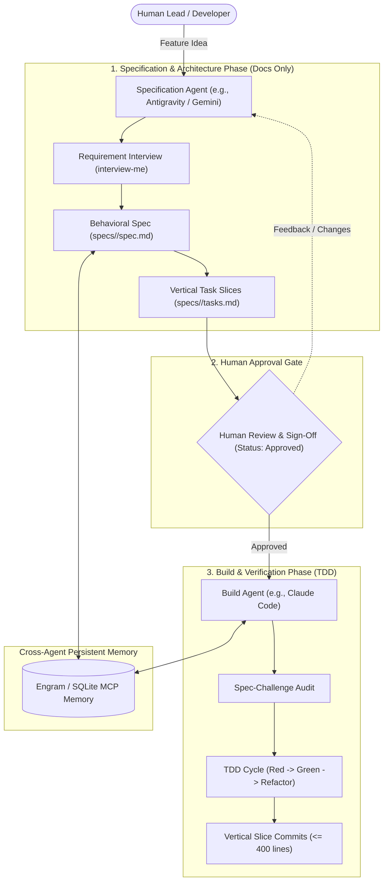

# Architecture & Philosophy: The Spec-Driven Multi-Agent Pattern

## The Problem: The "Single-Agent Trap"

Most developers interact with AI coding assistants in an **ad-hoc, monolithic loop**:
1. Prompt an agent with a broad feature request.
2. The agent generates architectural decisions, writes 500+ lines of ungrounded code, and approves its own solution.
3. Hidden assumptions, edge cases, and missing tests remain undetected until runtime.
4. When regressions occur, context windows overflow, causing context degradation and hallucinations.

This pattern violates fundamental software engineering principles: **Separation of Concerns**, **Verification Before Implementation**, and **Least Privilege**.

---

## The Solution: Specialized Dual-Agent Topology

The Spec-Driven AI Workflow enforces a formal separation of responsibilities between two decoupled agent roles:

---

## Key Architectural Principles

### 1. Specification Agent (Docs & Architecture Only)
* **Goal:** Extract what is actually needed, surface edge cases, define interfaces and acceptance criteria.
* **Bounded Scope:** Strictly prohibited from writing application code or executing builds. This prevents premature coding before requirements are validated.
* **Output:** Verifiable behavioral acceptance criteria (`S1`..`Sn`) expressed as `Given / When / Then`.

### 2. Mandatory Approval Stop Gate
* No code is written on assumptions.
* The specification starts with `Status: Draft`. Only the human engineer has the authority to transition it to `Status: Approved`.
* The Build Agent will strictly refuse to write code if `Status: Approved` is absent.

### 3. Build Agent (Test-Driven Implementation)
* **Goal:** Turn approved specifications into verified code.
* **Spec-Challenge Phase:** Before writing a single line of production code, the build agent audits the spec for contradictions or untestable criteria.
* **TDD Default (Red -> Green -> Refactor):**
  1. Write failing test for criterion `S#`.
  2. Implement minimal passing code.
  3. Refactor with zero regression.
* **Bounded Slices:** Commits are restricted to vertical slices of roughly `<= 400` changed lines.

### 4. Shared Persistent Memory
* Context windows are ephemeral; files and memory databases are permanent.
* Agents share architectural decision records (ADRs), ubiquitous domain glossaries, and persistent memory (via Engram / MCP) across sessions.
