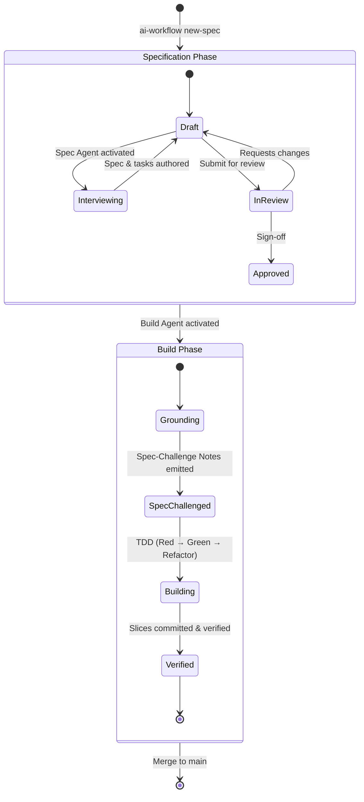

# Agent Handoff Protocol & Lifecycle

This document describes the state machine governing handoffs between the **Specification Agent** and the **Build Agent**.

---

## The Specification State Machine



---

## Artifact Contracts

All state transitions are persisted in `specs/<change-slug>/`:

### 1. `spec.md` (Behavioral Contract)
- **Header Metadata:**
  ```yaml
  Change ID: <change-slug>
  Status: Draft | Approved
  Approved By: <human-name | pending>
  Approval Date: <YYYY-MM-DD | pending>
  Author Agent: <Agent Name>
  ```
- **Requirements (`S1`..`Sn`):** Falsifiable, deterministic acceptance criteria covering happy paths, boundary inputs, and structured error conditions.
- **Boundaries & Out-of-Scope:** Explicit list of what is excluded to prevent scope creep.

### 2. `tasks.md` (Vertical Slices Breakdown)
- Breaks requirements into dependency-ordered vertical units (`T1`..`Tn`).
- Each task maps to:
  - Specific `S#` requirement IDs.
  - Risk tier (Tier 1 low, Tier 2 medium, Tier 3 high).
  - Target files and test paths.
  - Exact verification command from `AGENTS.md`.

### 3. `handoff.md` (Cross-Agent Execution Log)
- **Spec-Challenge Notes:** Findings, contradictions, or clarifications surfaced by the Build Agent before coding.
- **Build Progress Table:** Tracks status, commit SHAs, and test command execution for each slice.
- **Post-Build Audit:** Record of diff inspection against `spec.md`.

---

## Verification Gates Checklist

Before a task is declared **Done**:
- [ ] All `S#` acceptance criteria in `spec.md` have passing behavioral tests.
- [ ] Verification commands (`test`, `lint`, `typecheck`, `build`) in `AGENTS.md` exit with code 0.
- [ ] Commits follow Conventional Commits without AI attribution.
- [ ] No secrets or scratch files left in working tree.
- [ ] Architectural decisions recorded in `docs/adr/`.
